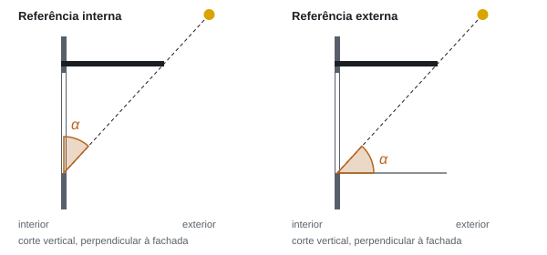
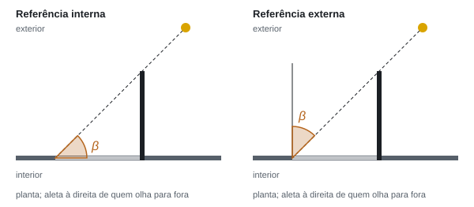
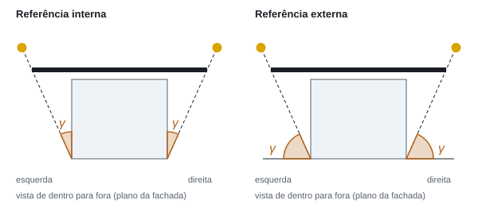

# 1. Convenções geométricas

**Status:** v0, aprovada pelo Anthony no portão 0 (23/10/2026, decisão 0011). Itens marcados **[conferir no 6.2]** foram adotados, mas ainda serão conferidos contra o SOL-AR 6.2 em execução (F2.2 e F2.8); se o 6.2 divergir, a diferença é registrada e decidida com o Anthony.

## 1.1 Direções no céu

- **Azimute** (A): ângulo horizontal a partir do Norte geográfico, no sentido horário, em graus no intervalo [0, 360). N = 0°, L = 90°, S = 180°, O = 270°.
- **Altura solar** (h): ângulo acima do plano do horizonte, de 0° (horizonte) a 90° (zênite). **Ângulo zenital** z = 90° − h.
- Vetor unitário da direção do sol, nas componentes (Leste, Norte, Cima):

  s = (cos h · sen A, cos h · cos A, sen h)

- Norte geográfico (verdadeiro), nunca magnético. A declinação magnética, se um dia for mostrada, é só informação ao usuário.

## 1.2 Fachada e referencial da fachada

- **Orientação da fachada** (A_f): azimute da **normal externa** (a direção para onde a fachada "olha"). Uma fachada norte tem A_f = 0°.
- Entrada de orientação: qualquer número real, inclusive negativo ou maior que 360; o programa normaliza para [0, 360). Ex.: −30° equivale a 330°. (O SOL-AR 6.2 só aceitava valores positivos.)
- Superfícies verticais apenas na v1. Superfícies inclinadas estão em `docs/ideias.md`.
- **Referencial da fachada** (x, y, z), usado em todas as fórmulas de máscara:
  - y: normal externa (horizontal, apontando para fora);
  - x: horizontal, no plano da fachada, **à direita de quem está dentro olhando para fora**;
  - z: vertical, para cima.
- **Ângulo azimutal relativo** do sol (ψ): diferença com sinal entre o azimute do sol e a normal da fachada, reduzida a (−180°, 180°]:

  ψ = A − A_f (reduzido); ψ > 0: sol à direita de quem olha para fora.

  Na literatura em inglês, |ψ| é o *horizontal shadow angle* (HSA).
- Componentes do sol no referencial da fachada:

  s_x = cos h · sen ψ, s_y = cos h · cos ψ, s_z = sen h

- O sol **está diante da fachada** quando s_y > 0 (|ψ| < 90°) e h > 0. Fora disso, a fachada está em sombra própria e nenhuma proteção é necessária.

**Direita e esquerda.** "À direita de quem está dentro olhando para fora" (portão 0). Na carta (vista de cima, Norte para cima), com o transferidor girado para a normal apontar para cima, esse lado coincide com a direita do papel. **Confirmado no código do SOL-AR 6.2** (F2.2): a reta de "Beta Direita" fica no azimute orientação + β_ext, no sentido horário a partir da normal, e o círculo de "Gama Direita" fica do lado direito; ver `docs/validacao/relatorios/F2.2-transferidor.md`.

## 1.3 Ângulos de sombra: α, β e γ

Os três ângulos descrevem a proteção vista de um ponto da abertura e são o vocabulário do ensino brasileiro (Bittencourt, *Uso das cartas solares*; Frota e Schiffer, *Manual de conforto térmico*; aulas do LabEEE). O SOL-AR 6.2 tem um seletor **"Ângulo de Referência: Interna / Externa"** que muda a linha a partir da qual cada ângulo é medido. Os diagramas que o próprio 6.2 mostra para cada caso, extraídos do executável, estão em [`../referencias/solar-6.2/angulos-referencia-6.2.png`](../referencias/solar-6.2/angulos-referencia-6.2.png); as figuras abaixo os reproduzem.

Nas duas referências vale, para os três ângulos:

**valor externo = 90° − valor interno**

| Ângulo | Proteção que descreve | Plano onde é medido | Ponto da abertura (sombra de 100%) | Interna: medido a partir de | Externa: medido a partir de |
|---|---|---|---|---|---|
| α | brise horizontal (beiral, marquise) | corte vertical perpendicular à fachada (plano y–z) | base da abertura (peitoril) | plano da fachada (vertical) | horizontal (normal) |
| β | brise vertical (aleta) | planta (plano x–y) | aresta vertical **oposta** à aleta | plano da fachada | normal da fachada |
| γ | limite lateral de um brise horizontal finito, ou limite superior de um brise vertical finito | plano da fachada, vista de dentro para fora (plano x–z) | canto inferior do **mesmo lado** do limite | vertical (aresta da abertura) | horizontal (peitoril) |

As figuras são geradas por [`figuras/gerar_figuras.py`](figuras/gerar_figuras.py).

### Coerência com outras fontes

- **α interno** coincide com o **AVS** da INI-C (Inmetro, 2020, item 4.7: ângulo entre o plano vertical na base da folha de vidro e o plano que passa pela extremidade mais distante da proteção) e com a figura da aula "Orientação e diagrama solar" do LabEEE (Lamberts), em que α é marcado a partir da vertical no corte e transferido para o transferidor a partir do zênite.
- **β interno** coincide com o **AHS** da INI-C (item 4.8: ângulo entre o plano que contém a base da folha de vidro e o plano que passa pela extremidade mais distante da aleta e pela extremidade **oposta** da base).
- **α externo** é o *vertical shadow angle* (ângulo de perfil) da literatura em inglês; **β externo** é o *horizontal shadow angle*.
- A INI-C limita AVS a 0° a 90° e AHS a 0° a 80° no metamodelo; aqui os ângulos aceitam 0° a 90°.

### Ângulos do sol nas mesmas grandezas

Para comparar o sol com uma proteção, calculamos os ângulos que a própria direção do sol faz nos mesmos planos (sol diante da fachada, s_y > 0):

- α do sol (externo, ângulo de perfil): tan α_ext,sol = s_z / s_y = tan h / cos ψ
- β do sol (externo): β_ext,sol = |ψ|, do lado de ψ (direita se ψ > 0)
- γ do sol (externo): tan γ_ext,sol = s_z / |s_x| = tan h / |sen ψ|, do lado de ψ

Os valores internos são 90° menos os externos.

**Referência padrão:** o transferidor abre na referência **interna** (portão 0), que coincide com AVS e AHS da INI-C e com o material de aula do LabEEE; a externa fica a um clique.

### Condições de sombra (sombra de 100%, proteções infinitas ou limitadas)

Com os ângulos em referência **externa**:

| Proteção | O sol está bloqueado quando |
|---|---|
| Brise horizontal infinito, ângulo α | α_ext,sol ≥ α_ext |
| Aleta vertical infinita à direita, ângulo β | ψ > 0 e β_ext,sol ≥ β_ext (idem à esquerda com ψ < 0) |
| Brise horizontal finito: α limitado por γ à direita | α_ext,sol ≥ α_ext **e**, se ψ > 0, γ_ext,sol ≥ γ_ext,direita (idem à esquerda) |
| Aleta vertical finita: β limitado pelo topo | condição de β **e** γ_ext,sol ≤ γ_ext do topo da aleta ("γ das aletas", medido do canto superior **oposto**) |

As três primeiras linhas foram verificadas numericamente contra traçado de raios (ponto na abertura, raio até o sol, interseção com a placa) em 20 000 casos aleatórios cada; a quarta, com os pontos de referência da seção 1.6, no F2.3 (`docs/validacao/relatorios/F2.3-mascara.md`). O 6.2 não ajuda aqui: ele só desenha as curvas de γ, e a região da máscara era pintada à mão.

### Índices 1 e 2

O SOL-AR 6.2 tem campos α1 e α2, β direita 1 e 2, β esquerda 1 e 2, γ direita 1 e 2, γ esquerda 1 e 2; o campo "2" só fica ativo depois do "1". O "2" representa brises afastados da parede (tutorial do SOL-AR da UFU, de Bortoli e Saramago, p. 11 e 15; decisão 0014): a fresta junto à parede deixa passar o sol, e a sombra fica entre duas curvas, a da aresta externa (índice 1) e a da aresta interna (índice 2). Para o brise horizontal, o sol é bloqueado quando α_ext,1 ≤ α_ext,sol ≤ α_ext,2.

**O que o código do 6.2 faz** (F2.2): ordena os dois valores, desenha as duas curvas e, sem o índice 2, usa 90° externo como segundo limite (para α e γ, a linha da fachada, que não é desenhada como curva; para β, a linha da fachada do lado). A região em si não existia no 6.2 (era pintada à mão).

**O que o novo faz** (F2.3): mantém os índices na ordem digitada, porque a máscara depende de qual é a aresta externa e qual a interna. Se o índice 2 der um ângulo externo menor que o do 1, não há direção que a janela inteira veja atrás do brise, e a sombra total é vazia. Os pontos da janela de onde cada índice é medido estão na seção 1.6.

## 1.4 Curvas do transferidor

Cada valor de α, β ou γ corresponde a um plano que passa pelo observador; na esfera celeste, esse plano é um círculo máximo, e na projeção estereográfica (seção 3) um círculo máximo vira uma circunferência ou uma reta. Por isso as curvas do transferidor são exatas, não aproximações:

| Curva | Plano | Polo do plano (referencial da fachada) | Imagem na carta |
|---|---|---|---|
| α constante | contém o eixo x, inclinado α_ext sobre a horizontal | m = (0, −sen α_ext, cos α_ext) | arco que passa pelos dois pontos do horizonte no plano da fachada (ψ = ±90°) |
| β constante | vertical, azimute relativo ±β_ext | horizontal | reta radial pelo centro da carta |
| γ constante, à direita | contém o eixo y, inclinado γ_ext sobre a horizontal | m = (−sen γ_ext, 0, cos γ_ext) | arco que passa pelos pontos do horizonte na normal (ψ = 0°) e na direção oposta (ψ = 180°) |

As fórmulas do centro e do raio de cada arco estão na seção 3.3.

## 1.5 Unidades e formatos

- Ângulos em graus na interface e nos arquivos; radianos só dentro dos cálculos.
- Unidades SI na interface: °C, %, m/s, W/m² (irradiância), Wh/m² (irradiação horária), m, cm (raio da carta impressa).
- Português: vírgula decimal e ponto de milhar (1.234,5). Os arquivos exportados (CSV) usam ponto decimal e vírgula como separador, para abrir em qualquer programa; a escolha fica registrada no cabeçalho do arquivo.

## 1.6 Máscara pelos ângulos (F2.3)

A máscara é a região da carta em que o sol fica atrás da proteção. No 6.2 ela era pintada à mão sobre as curvas do transferidor; no novo, é calculada a partir dos mesmos ângulos (decisão 0014). O desenho à mão continua como opção.

### Dois conjuntos de ângulos

| Conjunto | Onde | Ponto da janela de onde se mede | Cor |
|---|---|---|---|
| Sombra total (100%) | campos principais (α, β, γ) e "Mais opções" (índices 2, γ das aletas) | arestas e cantos que tornam a condição válida para a janela inteira (tabela abaixo) | vermelho |
| Sombra parcial (50%) | "Mais opções", opcional, com os mesmos campos | centro da janela, para todos os ângulos | amarelo |

A região parcial desenhada é a região do conjunto parcial **menos** a total.

**Pontos de referência da sombra total.** Para cada aresta da proteção, vale o ponto da janela em que a condição de sombra é mais difícil de cumprir (o "pior" ponto): se ele está à sombra daquela aresta, a janela inteira está.

| Ângulo | Aresta da proteção | Ponto da janela |
|---|---|---|
| α1 | aresta externa do brise | base (peitoril) |
| α2 | aresta interna do brise (afastado da parede) | verga (topo da janela) |
| γ direita, γ esquerda | ponta do brise daquele lado | canto inferior do mesmo lado |
| β1 | aresta externa da aleta | aresta vertical oposta à aleta |
| β2 | aresta interna da aleta (afastada da parede) | aresta vertical do mesmo lado da aleta |
| γ das aletas | topo da aleta | canto superior oposto à aleta |

α2 e β2 são medidos de pontos diferentes dos de α1 e β1: pela fresta, o sol chega primeiro à verga (no brise) e à aresta do mesmo lado (na aleta). Medir α2 da base ou β2 da aresta oposta superestima a proteção; o traçado de raios detecta as duas trocas (relatório do F2.3).

**Critério de 50%.** O centro da janela vê o sol atrás da proteção. Para brises e aletas infinitos e sem fresta, a parte sombreada é uma faixa da janela que começa na borda junto à peça, e o centro fica à sombra se, e só se, a faixa cobre pelo menos metade da janela. Com fresta ou com peças finitas, é uma aproximação. A fração exata, com curvas de 0% a 100%, vem da máscara pela geometria (F3.1 a F3.3).

### Região de cada proteção (ângulos externos)

Com ψ o ângulo azimutal relativo (seção 1.2), α_sol o ângulo de perfil e γ_sol o ângulo do sol no plano da fachada (seção 1.3), o sol à frente da fachada (|ψ| < 90°) e acima do horizonte é bloqueado:

- **Brise horizontal:** α_ext,1 ≤ α_sol e, com índice 2, α_sol ≤ α_ext,2; se ψ > 0 e γ direita for dado, γ_sol ≥ γ_ext,direita; se ψ < 0 e γ esquerda for dado, γ_sol ≥ γ_ext,esquerda.
- **Aleta à direita:** ψ ≥ β_ext,1 e, com índice 2, ψ ≤ β_ext,2; com γ das aletas, γ_sol ≤ γ_ext,aleta. À esquerda, o mesmo com −ψ.
- **Conjunto:** união do brise e das aletas.

**γ2 não muda a máscara.** A aresta lateral de um brise retangular é paralela à normal da fachada; vista no plano da fachada, as suas duas pontas (junto à parede e na frente) são um ponto só, e dão o mesmo γ. O campo γ2 é desenhado no transferidor, como no 6.2, mas não entra no cálculo. O mesmo vale para o topo das aletas, que tem um campo só.

**União das proteções.** A união das regiões de cada peça é exata com uma peça só e com aletas dos dois lados (para cada direção do sol, só a aleta daquele lado atua). Numa **grelha** (brise encostado nas aletas, com a mesma profundidade, junto à parede), as junções fecham as frestas e a luz só entra pela abertura da frente; os piores pontos de α1 e de β1 coincidem no canto inferior oposto à aleta, e por isso, deixando γ e γ das aletas em branco, a união de α1 e β1 é exata. Com brise e aletas de pontas livres, partes diferentes da janela podem ser sombreadas por peças diferentes, e a união é só uma parte da sombra total real (nunca maior que ela). Na grelha do relatório, digitar os γ como se as pontas fossem livres reduz a região total a cerca de metade da real (413 de 787 direções). Para o critério do centro (50%), a união é sempre exata, porque se trata de um ponto só.

### Na carta

Todas as bordas são imagens de planos pelo observador (seção 3.2 da spec 03): círculos (α, γ, γ das aletas) e retas pelo centro (β e a linha da fachada). Cada região é calculada como interseção e união de discos e semiplanos da carta, sem aproximar as bordas por polígonos: o disco de α contém as direções com perfil maior que α (e as de trás da fachada, que o semiplano da fachada exclui); o disco de γ de um lado contém as direções daquele lado com γ_sol maior que γ (e todo o outro lado). Implementação: `src/core/mask/mask.ts`; desenho em `src/ui/mask/MaskLayer.tsx` (máscaras SVG).

### Desenho à mão

Como no 6.2, o usuário marca na carta os vértices de regiões de sombra total ou parcial. Os lados são segmentos retos na carta (não arcos), os vértices ficam guardados no link como direções do céu (azimute e altura, 0,1°) e a região desenhada se soma à calculada do mesmo tipo.

### Validação

- Traçado de raios com janela e placas reais em 9 casos (brise infinito, finito e afastado; aletas infinita, finita e afastada; duas aletas; grelha; grelha com γ digitado; brise e aletas soltos), 1500 direções do sol por caso: nenhuma direção classificada de forma errada na sombra total onde a união é exata, nenhum falso positivo nos demais, e o critério do centro igual ao traçado em todas as direções de todos os casos. Tolerância: zero erros de classificação nas direções amostradas.
- Casos analíticos: a borda do brise infinito é a curva α (±0,01°).
- Caso da literatura: exemplo do tutorial do SOL-AR da UFU em Brasília (verificação qualitativa; relatório do F2.3).

## Referências

- Bittencourt, L. *Uso das cartas solares: diretrizes para arquitetos*. 4. ed. Maceió: EDUFAL, 2004.
- Frota, A. B.; Schiffer, S. R. *Manual de conforto térmico*. São Paulo: Studio Nobel.
- Lamberts, R. *Aula 5: Orientação e diagrama solar* (Desempenho térmico de edificações, LabEEE/UFSC), slides 26 a 37: https://labeee.ufsc.br/sites/default/files/disciplinas/Aula-Orientacao%20e%20Diagrama%20solar.pdf
- Inmetro. *Instrução Normativa Inmetro para a Classe de Eficiência Energética de Edificações Comerciais, de Serviços e Públicas (INI-C)*, 2020, itens 4.6 a 4.8: https://labeee.ufsc.br/sites/default/files/documents/INIC_Dez2020.pdf
- SOL-AR 6.2 (LabEEE/UFSC, 2009): formulário principal (`TFormSolar`) do executável `ProjSolar.exe`, imagens `IAlfaInterno`, `IAlfaExterno`, `IBetaInterno`, `IBetaExterno`, `IGamaInterno`, `IGamaExterno` e seletor `rgAngulos` ("Interna", "Externa").
